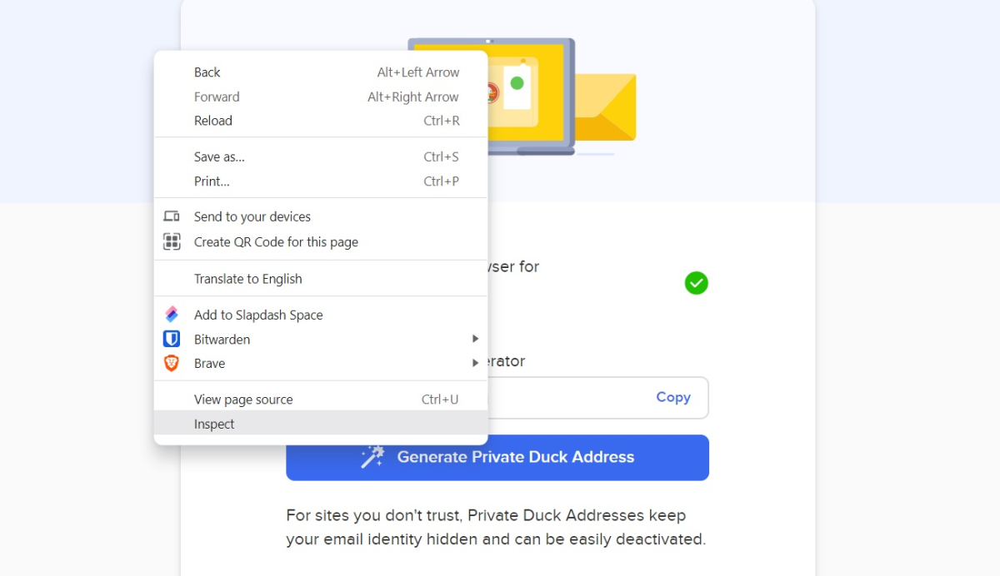
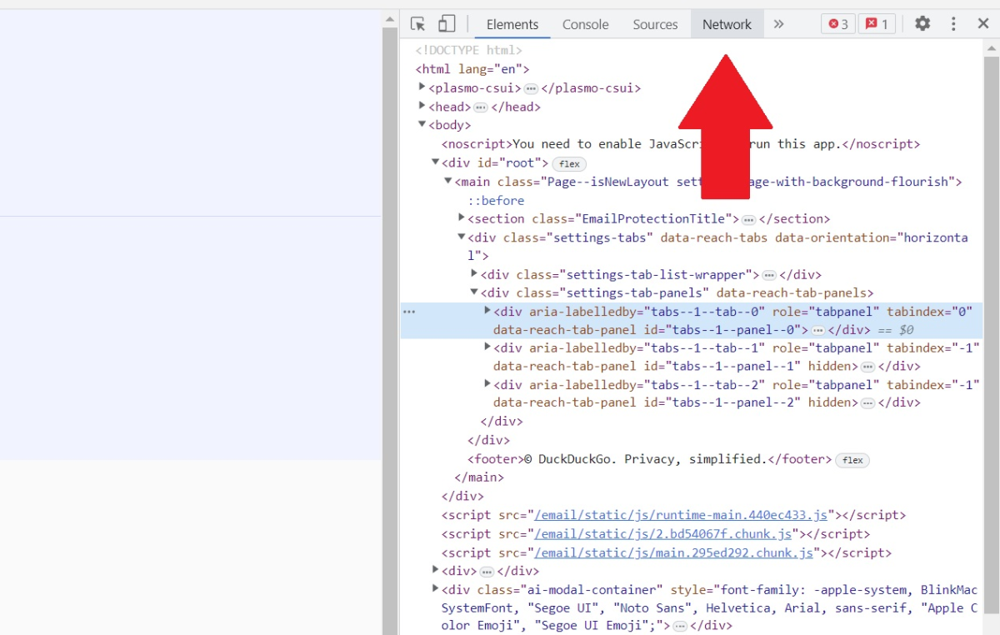
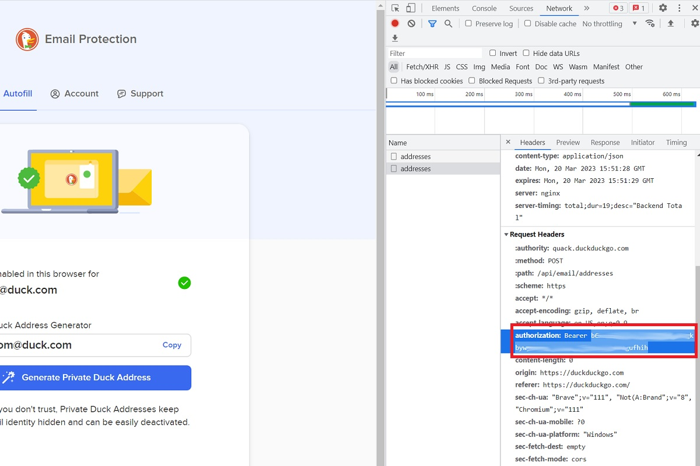

# GoAlias - DuckDuckGo Email Alias Generator and History Tracker

This project includes scripts to generate DuckDuckGo email aliases and store the history of generated aliases.

## Configuration

### Obtain the DuckDuckGo API Key

1. [Install the DuckDuckGo web browser extension](https://duckduckgo.com/email/).
2. [Set up the Email Protection feature](https://duckduckgo.com/email/).

From here, follow these steps closely:

- From DuckDuckGo’s email autofill page, right-click anywhere on the page and select “Inspect” from the context menu.

  

- In the developer tools panel, click the “Network” tab at the top.

  

- On the DuckDuckGo site next to the sidebar, click the “Generate Private Duck Address” button.

- In the developer panel sidebar, click on the word “addresses.”

  

- Scroll down until you see the words “authorization: Bearer,” followed by a long string of letters and numbers.

- Copy the long string of letters and numbers (without the “authorization: Bearer” portion) to your clipboard.

> **Note**: You can delete the DuckDuckGo web browser extension after obtaining the API key.

## For Bash 

### Installation

0. **Build the binary:**
   ```bash
   go build GoAlias.go
   ```

2. **Download the binary:**
   Save the binary as `GoAlias` in a directory of your choice.

3. **Make the binary executable:**
   ```bash
   chmod +x GoAlias
   ```

4. **Set Your DuckDuckGo API Key:**
   Run `GoAlias` and replace the placeholder API key with your actual key:
   ```bash
   API_KEY = "YOUR_API_KEY_HERE" ./GoAlias
   ```

5. **Move the binary to a directory in your `$PATH`:**
   ```bash
   mv GoAlias /usr/local/bin/GoAlias
   ```

### Usage

#### Generate an Email Alias

To generate a new DuckDuckGo email alias:
```bash
GoAlias generate
```

#### View Alias History

To view the history of generated aliases:
```bash
GoAlias history
```

#### Interactive Menu

To use the interactive menu:
```bash
GoAlias
```

The script will present the following options:
1. Generate email alias
2. Show aliases history

### History File

The history of generated aliases is stored in `~/.local/share/ddg/aliases_history.txt`. Each entry includes the timestamp and the generated email alias.

## License

This project is licensed under the GPL-3.0 License. See the LICENSE file for details.

## Contributing

Contributions are welcome! Please fork this repository and create a pull request with your changes. For major changes, please open an issue first to discuss what you would like to change.
